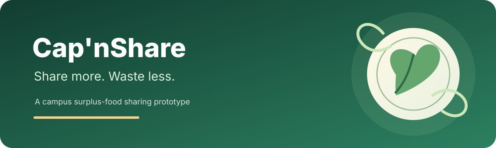
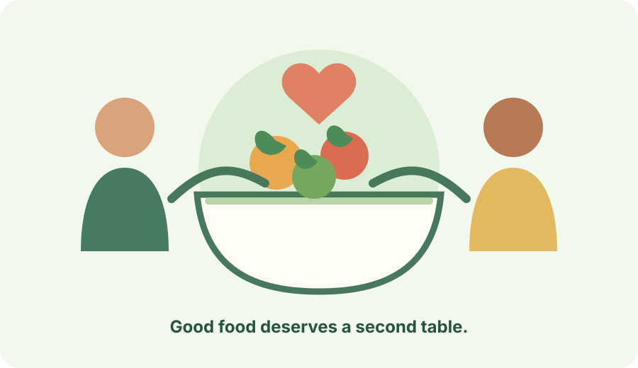
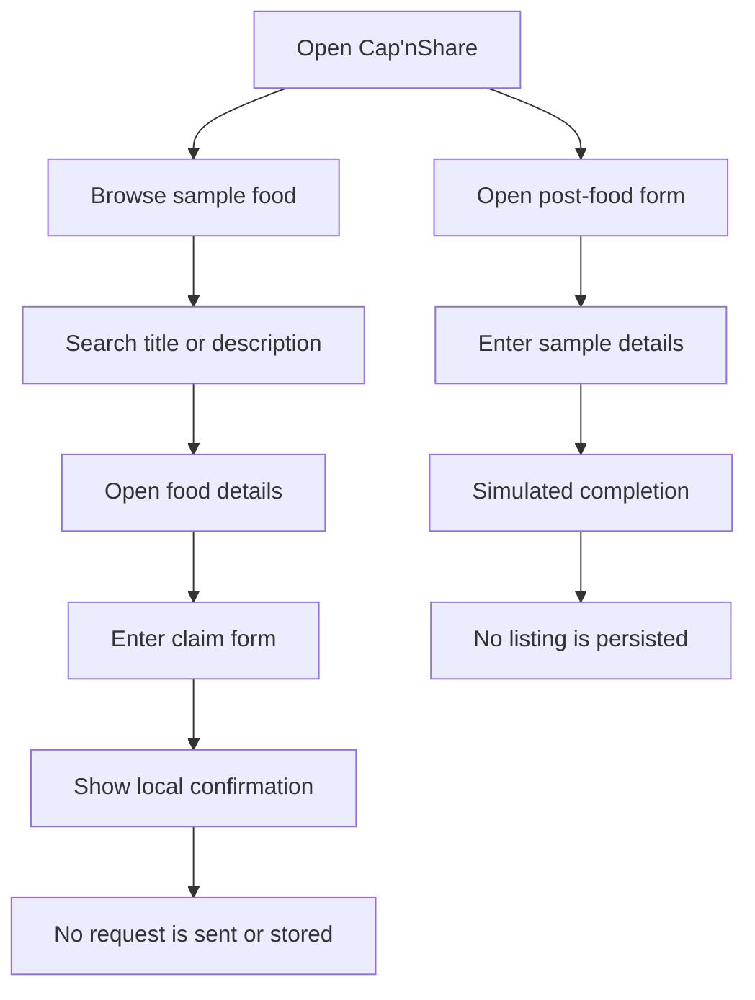

<div align="center">



# 🍱 Cap'nShare

### Share more. Waste less. Build a more thoughtful campus food community.

A campus-oriented surplus-food sharing interface concept built with React, TypeScript, and Vite.

[](https://react.dev/)
[](https://www.typescriptlang.org/)
[](https://vite.dev/)
[](https://tailwindcss.com/)
[](LICENSE)
[](ROADMAP.md)

[📖 Documentation](docs/README.md) · [🗺️ Architecture](docs/architecture.md) · [🧪 Testing](docs/testing.md) · [🤝 Contributing](CONTRIBUTING.md) · [🔐 Security](SECURITY.md)

</div>

---

## 🌱 About the project

Food surplus can happen after campus events, meetings, and shared meals. Cap'nShare explores how a campus community might make surplus portions visible to people who could use them.

The repository currently contains a **frontend prototype**, not a functioning food-exchange service. It demonstrates the user experience through sample food listings, detail pages, mock account screens, a dashboard, and donor/recipient-oriented forms.

> [!WARNING]
> **Prototype only:** Login, signup, posting, claiming, and profile flows are simulated. There is no backend, verified identity, durable listing storage, food-safety review, messaging, or pickup coordination. Do not use this interface to arrange real food pickups or enter real personal information.

## ✨ What the interface demonstrates

| Area | Current behavior |
|---|---|
| 🏠 Landing page | Project introduction, sample impact figures, testimonials, and calls to action |
| 🔐 Login and signup | Mock authentication through a client-side context |
| 📊 Dashboard | Static sample metrics and food posts |
| 🔎 Food discovery | Sample listings and title/description search |
| 🍲 Food details | Detail view for sample records |
| 🙋 Claim interaction | Simulated confirmation, no request is sent or persisted |
| ➕ Post food | Form demonstration, no listing is created |
| 👤 Profile | Mock profile and local UI state |
| 📱 Responsive layout | Tailwind-based responsive interface |

### Current implementation boundaries

- Search filters the in-memory sample data by title and description.
- Location, distance, availability-time, and sort controls are visual controls only.
- Food posts come from a fixed array in `src/data/mockData.ts`.
- Login/signup accept form input through a mock context. No account is created or verified.
- The mock profile is stored in browser `localStorage`; it is not a secure session.
- Posting and claiming show success-like UI transitions without saving data or contacting another user.
- The app does not enforce route authorization.
- Landing-page impact figures and testimonials are static sample content, not measured results.

## 🖼️ Project visual

<div align="center">
  
</div>

## 🧰 Technology stack

| Technology | Purpose |
|---|---|
| React 18 | Component-based UI |
| TypeScript 5 | Static typing |
| Vite 5 | Development server and production bundler |
| React Router 6 | Client-side routing |
| Tailwind CSS 3 | Utility-first styling |
| Lucide React | Interface icons |
| ESLint 9 | Static code-quality checks |

Declared dependency ranges and exact lockfile resolutions are maintained in `package.json` and `package-lock.json`.

## 🚀 Getting started

### Prerequisites

- Git
- Node.js compatible with the Vite version declared in the lockfile
- npm

No database, API server, or environment variable is required for the current prototype.

### Installation

```bash
git clone https://github.com/Brajesh31/cap-and-share.git
cd cap-and-share
npm ci
npm run dev
```

Open the local URL printed by Vite, usually `http://localhost:5173`.

### Available commands

| Command | Description |
|---|---|
| `npm run dev` | Start the Vite development server |
| `npm run build` | Generate the production bundle in `dist/` |
| `npm run preview` | Preview the latest production build |
| `npm run lint` | Run ESLint |

There is currently no test runner or test script. A successful build is not proof that every user journey works.

## 🧭 Application routes

| Route | Screen | Current behavior |
|---|---|---|
| `/` | Landing | Project introduction and sample content |
| `/login` | Login | Mock login form |
| `/signup` | Signup | Mock signup form |
| `/dashboard` | Dashboard | Static sample dashboard |
| `/food` | Food listings | Sample list and text search |
| `/food/:id` | Food details | Sample detail and simulated claim |
| `/post-food` | Post food | Form with simulated completion |
| `/profile` | Profile | Mock profile and fixed statistics |
| Other paths | Not found | Fallback screen |

Routes are defined in `src/App.tsx`. The dashboard, post-food, and profile paths are not protected by authentication.

## 🏗️ Project structure

```text
cap-and-share/
├── .github/
│   ├── ISSUE_TEMPLATE/             # Bug, feature, and security issue guidance
│   ├── workflows/                  # Repository automation
│   └── pull_request_template.md
├── docs/
│   ├── assets/                     # Original SVG project visuals
│   ├── diagrams/                   # Mermaid architecture and workflow diagrams
│   ├── runbooks/                   # Operational and troubleshooting procedures
│   ├── templates/                  # Reusable project/review templates
│   ├── accessibility.md
│   ├── api.md
│   ├── architecture.md
│   ├── database.md
│   ├── deployment.md
│   ├── development.md
│   ├── food-safety.md
│   ├── installation.md
│   ├── observability.md
│   ├── privacy.md
│   ├── product-requirements.md
│   ├── release-process.md
│   ├── testing.md
│   ├── threat-model.md
│   └── troubleshooting.md
├── src/
│   ├── components/
│   │   ├── food/                   # Food cards
│   │   └── layout/                 # Shared header and footer
│   ├── context/                    # Mock authentication context
│   ├── data/                       # Static food data
│   ├── pages/
│   │   ├── auth/
│   │   ├── dashboard/
│   │   ├── food/
│   │   └── profile/
│   ├── types/                      # TypeScript domain types
│   ├── App.tsx
│   ├── index.css
│   └── main.tsx
├── index.html
├── package.json
├── package-lock.json
├── tailwind.config.js
├── tsconfig*.json
└── vite.config.ts
```

The tree above is a guide to the repository's organization. Consult the actual source tree for the complete file list.

## 🔄 Current user journey



The dotted boundary is intentional: the current UI demonstrates interaction states, not a completed exchange.

## 📚 Documentation library

Start at the [documentation hub](docs/README.md).

| Category | Documentation |
|---|---|
| 🧱 Engineering | [Architecture](docs/architecture.md) · [Development](docs/development.md) · [Installation](docs/installation.md) · [API boundaries](docs/api.md) · [Data and persistence](docs/database.md) |
| 🧪 Quality | [Testing strategy](docs/testing.md) · [Accessibility](docs/accessibility.md) · [Troubleshooting](docs/troubleshooting.md) |
| 🔐 Trust and safety | [Security](SECURITY.md) · [Threat model](docs/threat-model.md) · [Privacy](docs/privacy.md) · [Food safety](docs/food-safety.md) |
| 🚀 Operations | [Deployment](docs/deployment.md) · [Release process](docs/release-process.md) · [Observability](docs/observability.md) · [Runbooks](docs/runbooks/README.md) |
| 🧭 Product | [Product requirements](docs/product-requirements.md) · [FAQ](docs/faq.md) · [Glossary](docs/glossary.md) · [Roadmap](ROADMAP.md) |
| 🧰 Reusable resources | [Templates](docs/templates/README.md) · [Diagrams](docs/diagrams/README.md) |

## 🛡️ Safety, privacy, and security

A real food-sharing service has responsibilities beyond rendering a listing card. Before any real-world pilot, the project would need:

- Verified identity and server-side authorization.
- Donor ownership checks and a durable claim lifecycle.
- Clear ingredient/allergen disclosures and explicit unknown states.
- Safe pickup, cancellation, reporting, and moderation processes.
- Privacy-preserving handling of contact and pickup information.
- Abuse prevention, rate limits, auditability, and incident response.
- Qualified local review of food-safety requirements.

The current prototype does not provide these controls. Read [Food Safety](docs/food-safety.md), [Privacy](docs/privacy.md), and [Threat Model](docs/threat-model.md).

## 🧪 Quality checks

Run the checks available in the repository:

```bash
npm ci
npm run lint
npm run build
```

Manual route, responsive, keyboard, and browser-console checks are also required for UI changes. The detailed [testing guide](docs/testing.md) distinguishes existing checks from future test coverage.

## 🗺️ Roadmap

The roadmap is maintained in [ROADMAP.md](ROADMAP.md). Broad next steps include:

1. Validate the product problem with campus users.
2. Define data ownership, identity, and authorization boundaries.
3. Design a durable listing and claim lifecycle.
4. Establish food-safety, privacy, and moderation procedures.
5. Add backend/API and persistence only after requirements are validated.
6. Introduce automated tests and CI quality gates.
7. Run a limited, supervised pilot only after operational and safety review.

## 🤝 Contributing

Contributions are welcome. Before opening a pull request:

1. Read [CONTRIBUTING.md](CONTRIBUTING.md).
2. Check existing issues and the [roadmap](ROADMAP.md).
3. Keep changes focused and preserve the prototype boundary in documentation.
4. Run lint/build and describe exactly what you tested.
5. Update relevant docs, diagrams, and templates.

Use the [pull request template](.github/pull_request_template.md) to describe validation and risks.

## 🔐 Reporting security issues

Please do not publish exploitable security details in public issues. Follow the private reporting guidance in [SECURITY.md](SECURITY.md).

## 📄 License and third-party assets

Project source is offered under the [MIT License](LICENSE). Dependencies, externally hosted photos, fonts, and other third-party assets may have separate terms. Verify those terms before redistribution.

---

<div align="center">

### 🌍 Share more. Waste less. Start with a better system.

**Cap'nShare is a prototype for exploring responsible campus food sharing.**

[⬆ Back to top](#-capnshare)

</div>

_Last updated: 2026-11-18 19:53 UTC
